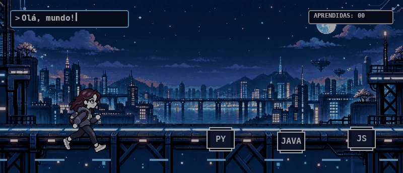

# 👾 Oiê, eu sou Dinara!

### PLAYER 01 · curiosidade alta · criatividade ligada · capricho no máximo
!

[]

---

## 🕹️ Quem está jogando?

Sou curiosa por natureza, criativa nas ideias e gosto de fazer as coisas com capricho. Curto aprender, explorar possibilidades e transformar boas ideias em algo real — de preferência com personalidade.

## 🚀 Fase atual

- **Aprendendo:** [Python]
- **Construindo:** [...]
- **Próxima missão:** [...]

## 📡 Encontre a player

